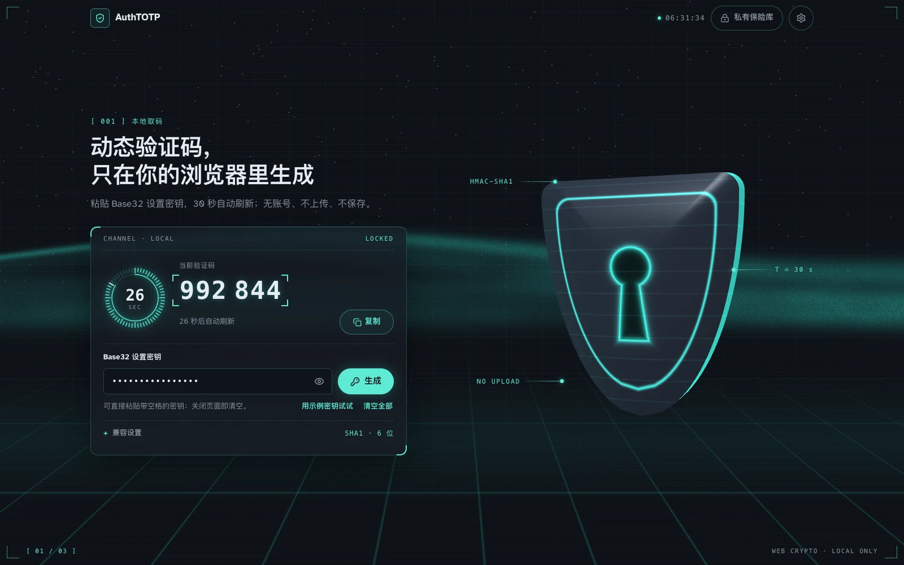
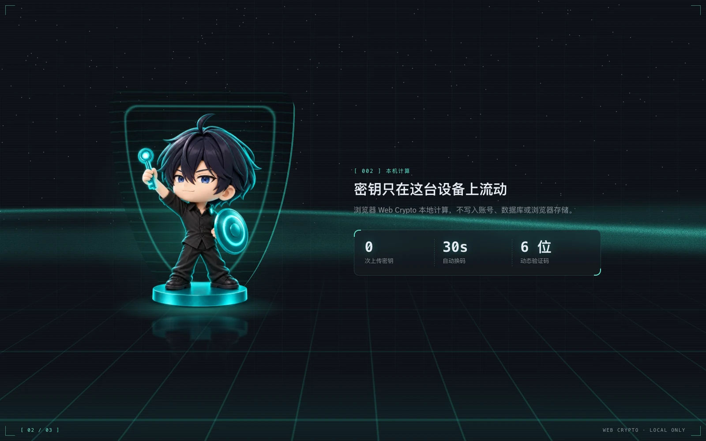
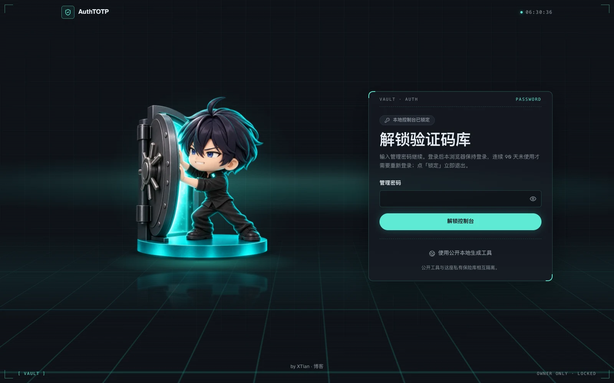

<!-- purpose: AuthTOTP Kit 对外说明：是什么、效果截图、要准备什么、怎么交给 AI 一次搭好 -->

# AuthTOTP Kit

**把这个仓库交给你的 AI 编程工具（Claude Code / Codex 等），它会在你自己的服务器上搭好一套 2FA 动态码系统，一直搭到你亲自确认能用为止。**

对你的 AI 说这一句就够了：

> 请阅读 https://github.com/xtianowner/authtotp-kit 里的 AGENTS.md，按它帮我部署自己的 2FA 保险库。

## 你会得到

- 🔓 **公开工具**（例如 `https://totp.你的域名`）：任何人粘贴自己的 Base32 密钥，就能在浏览器里生成 6 位动态码。**密钥不离开浏览器**：页面是纯静态文件，安全策略禁止它发出任何网络请求；密钥不写进任何存储，浏览器只记住你选的语言和字号。
- 🔐 **私有保险库**（例如 `https://vault.你的域名/vault`）：把你所有账号的 2FA 密钥加密存在你自己的服务器上，换手机、丢手机都不怕。登录需要管理密码加手机验证器的 6 位码。
- 🤖 **取码 API 与取码链接**：按条目给脚本或同事发一个只能取指定账号验证码的令牌，可以随时撤销，每次取码都有审计记录。

| 公开工具第二屏 | 保险库登录页 |
|---|---|
|  |  |

> 截图用的是虚构数据。

## 你需要准备

1. 一台能 SSH 登录的 Linux 服务器（Ubuntu 24.04 或 Debian 12，需要 Python 3.11 以上；root 或 sudo 权限，1 核 1G 就够）。
2. 一个你能管理 DNS 的域名，准备两个子域名：一个给公开工具，一个给保险库。
3. 手机上的验证器 App（Google Authenticator、Microsoft Authenticator、1Password 等都行）。
4. 一台电脑，加上一个 AI 编程工具。缺什么环境，AI 会帮你装。

需要你亲自动手的只有三件事：在 DNS 里加两条记录；经 SSH 隧道设置管理密码；用手机扫码绑定二步验证。AI 会在那一步停下来，告诉你该做什么。

## 安全设计（简版）

- 每条密钥用独立的数据密钥加密（AES-256-GCM），数据密钥再由主密钥包裹；主密钥是服务器上只有服务账号能读的文件，**不在数据库里**。
- 保险库只监听 `127.0.0.1`，公网流量只经 Caddy（自动 HTTPS）进来；服务进程在 systemd 沙盒里运行，不能主动外连。
- 刚部署好的服务器，首次设置管理密码和绑定手机验证器之前的登录，都**只接受从服务器本机经 SSH 隧道**发起，别人抢不走你的新服务器。
- 公开工具和保险库是两个独立域名，浏览器把它们当陌生人，公开页面碰不到保险库的登录状态。

完整的威胁模型和限制，见 AGENTS.md 里的「安全边界」一节。

## 形象与署名

默认带作者 **XTian** 的角色形象（首页、登录页、404），页脚有一行「by XTian」。部署时 AI 会问你选哪种：

- **用 XTian 的形象**：形象图片按 CC BY 4.0 授权，可以自由使用，但页脚的「by XTian」署名和链接要保留，见 `THIRD_PARTY_NOTICES.md`。
- **换成你自己的形象**：AI 会告诉你要准备哪三张图、规格多大，也能给你一段出图提示词。
- **都不要**：页面不放形象，署名可以改成你自己的，也可以去掉。

你的选择存在服务器上一个升级时不会被覆盖的文件里；以后想改，跟 AI 说一声即可。

## 许可

源代码：MIT（见 `LICENSE`）。字体、形象图片和第三方依赖各自的条款见 `THIRD_PARTY_NOTICES.md`。

by [XTian](https://blog.xtianowner.com/)
